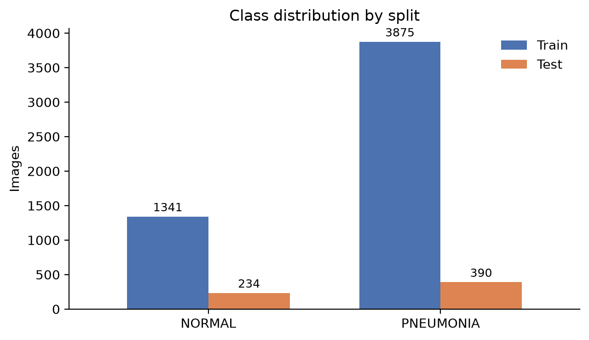
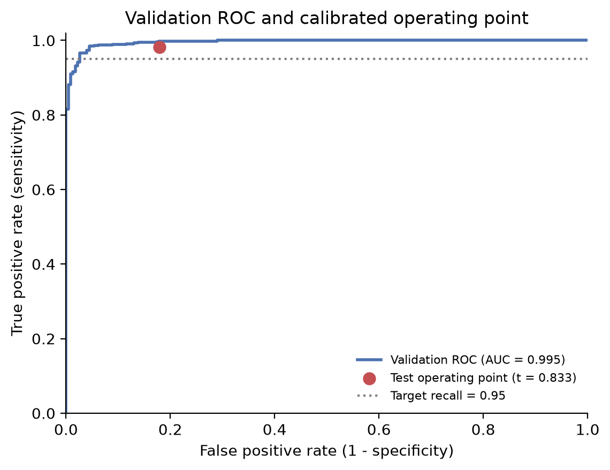
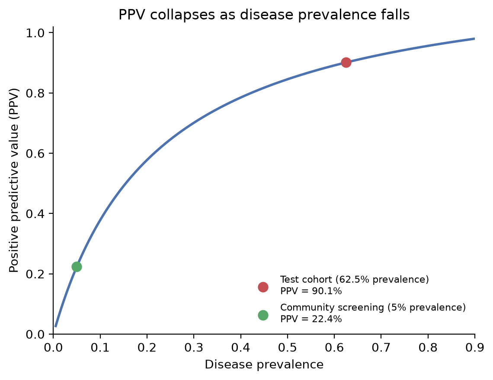
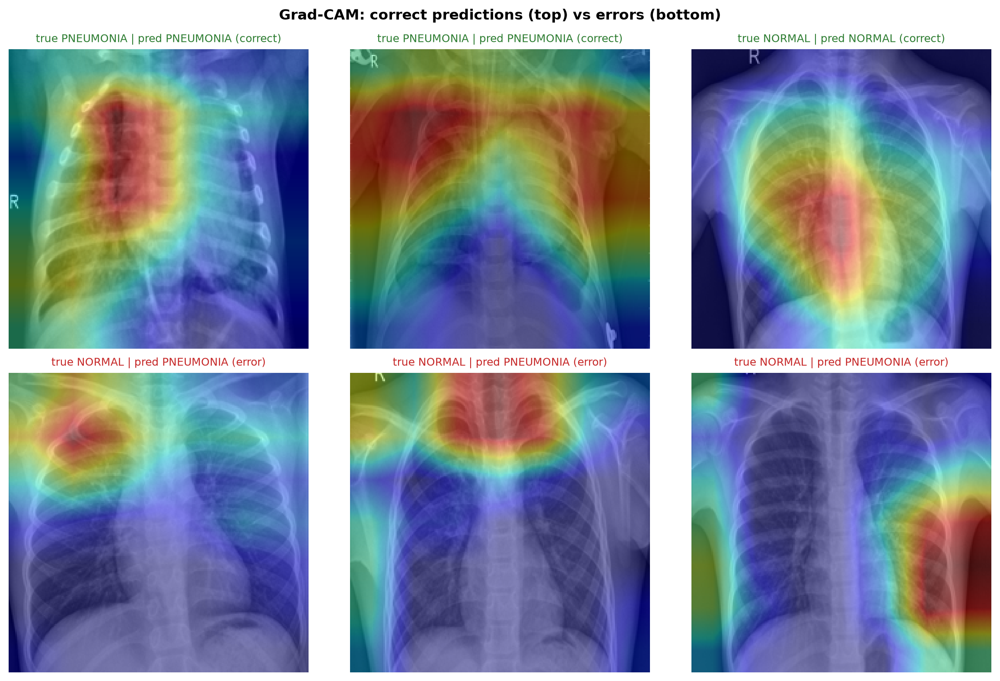

# Pediatric Chest X-Ray and Note API

**Course project** | Nosharwan Khan | 04102313037 | Introduction to AI | BS Electronics, Quaid-i-Azam University, Islamabad

This project wraps my Week 6 ResNet-18 chest X-ray classifier in a FastAPI service and carries forward selected note-processing work from Week 7. It exposes readiness, image prediction, and a combined image-and-note endpoint. The note rules are simple pattern matching and keyword checks.

> **Scope:** This is a classroom prototype. It has not been validated for patient care and must not guide diagnosis, treatment, discharge, or triage.

## What it does

- `GET /health` reports whether the model loaded and which classes it supports.
- `POST /predict` accepts a JPEG or PNG and returns the predicted label, class probabilities, and inference time.
- `POST /analyze` accepts an image and a short note, masks selected identifiers, extracts selected fields, and returns a rule-based result with reasons.

Uploads are limited to 5 MiB. The API returns 415 for unsupported image types, 413 for oversized files, 400 for unreadable image data, and 422 for missing or invalid required fields. Model inference runs in a thread pool so it does not block FastAPI's event loop.

## Model and evaluation context

The model is a grayscale ResNet-18 trained for `NORMAL` and `PNEUMONIA` classes at 224 × 224 pixels. Its transform follows the Week 6 checkpoint settings and ImageNet normalization. The original training folder contained 3,875 pneumonia and 1,341 normal images. The training work used weighted loss and a patient-grouped train/validation split.

The data audit also found 170 filename-derived patient groups shared between the original training and official test folders, covering 320 of 624 test images. The official test results may therefore be optimistic. These numbers are from the prior Week 6 evaluation, not a fresh external validation of this API.

At the validation-selected threshold of 0.833, the saved Week 6 results report sensitivity 0.982, specificity 0.821, and macro-F1 0.913. Assuming those sensitivity and specificity values transfer, estimated PPV at 5% prevalence is 0.224. This is a calculation, not a measured local clinic result. At the default argmax threshold, test macro-F1 was 0.862. Keep these operating points distinct.







The Grad-CAM review raised a possible shortcut concern: some false positives highlighted non-lung regions. A few heatmaps cannot establish why the model predicted a result, so shortcut learning remains a hypothesis.



## Run locally

Python 3.10 or newer is recommended. Put the trained checkpoint at `week6_model.pt` and the sample image at `sample.jpeg`; these files are excluded from Git. The checkpoint comes from the Week 6 project, which is linked below.

```bash
python -m venv .venv
source .venv/bin/activate
pip install -r requirements.txt
uvicorn app:app --host 127.0.0.1 --port 8000
```

Open [http://127.0.0.1:8000/docs](http://127.0.0.1:8000/docs) to try the endpoints. To use a checkpoint elsewhere, set `MODEL_PATH`. `POSITIVE`, `THRESHOLD`, and `API_KEY` can also be set through environment variables. Never put API keys in source control.

Example requests:

```bash
curl http://127.0.0.1:8000/health
curl -X POST http://127.0.0.1:8000/predict \
  -F 'file=@sample.jpeg;type=image/jpeg'
curl -X POST http://127.0.0.1:8000/analyze \
  -F 'file=@sample.jpeg;type=image/jpeg' \
  -F 'note=Fever and fast breathing. Call 0300-1234567.'
```

The example note is synthetic. Do not send real patient information. Regex masking only catches selected formats; it cannot guarantee that arbitrary notes are de-identified.

## Checks and measured performance

Run the tests with:

```bash
pytest -q test_api.py
```

The current suite reports **10 passed**, covering health, response schema, parity with direct model inference, file validation, size limits, required input, and masking/extraction checks.

The included `bench.py` sends 50 sequential requests to a running local server. On an Intel Core i7-1165G7 at 2.80 GHz with 8 logical CPUs and 7.4 GiB RAM, one run measured p50 **93.3 ms**, p95 **130.4 ms**, maximum **189.9 ms**, and sequential throughput about **9.7 requests/s**. Results depend on system load and are not a production capacity guarantee. The simple idealized capacity at p50 is `86,400,000 / 93.3`, or about 925,000 requests/day; real capacity depends on queueing, concurrency, network overhead, worker count, and available headroom.

## Notes from the lab

- A PDF sent to `/predict` should receive 415 because the endpoint accepts only JPEG and PNG. Invalid client input should be handled as a client error, not an unhandled server failure.
- The model loads once during application startup, avoiding repeated checkpoint reads and model construction for each request.
- If p50 is 40 ms and p95 is 400 ms, the long tail suggests some requests are much slower. Check load, queueing, image sizes, and CPU use.
- For 500,000 requests/day, average traffic is 5.79 requests/second. At five times average, demand is 28.94 requests/second. At 25 requests/second per worker, the arithmetic gives two workers before adding operational headroom.
- Synchronous inference inside an async endpoint can block the event loop. The service uses a thread pool for inference.
- Four team members have six pairwise communication channels: `4 × 3 / 2`.

## Source work

- [Week 6 project, notebook, and evaluation](https://github.com/nosharwankhan/lab6_computer_vision)
- [Original Chest X-Ray Images (Pneumonia) dataset](https://www.kaggle.com/datasets/paultimothymooney/chest-xray-pneumonia)
- [FastAPI documentation](https://fastapi.tiangolo.com/)
- [PyTorch model documentation](https://pytorch.org/vision/stable/models/resnet.html)

The Week 6 evaluation identified patient overlap in the official test set. Independent patient-disjoint evaluation and external validation are still needed before drawing conclusions about generalization.
